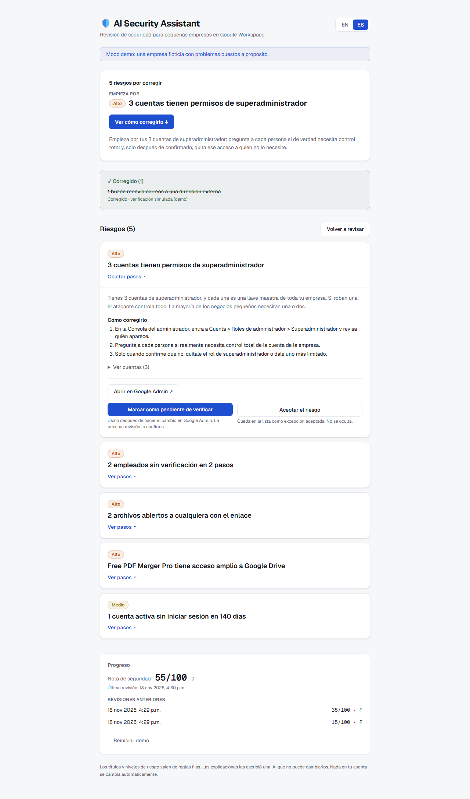
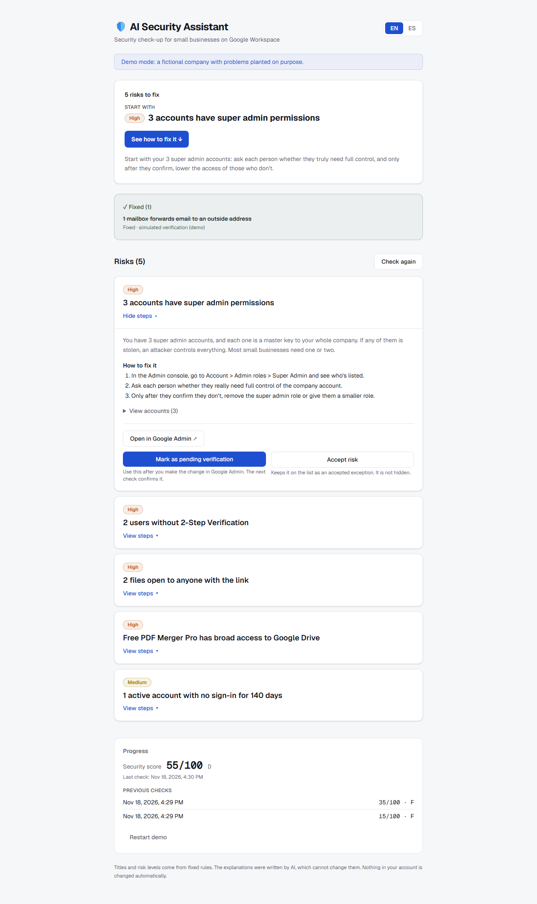
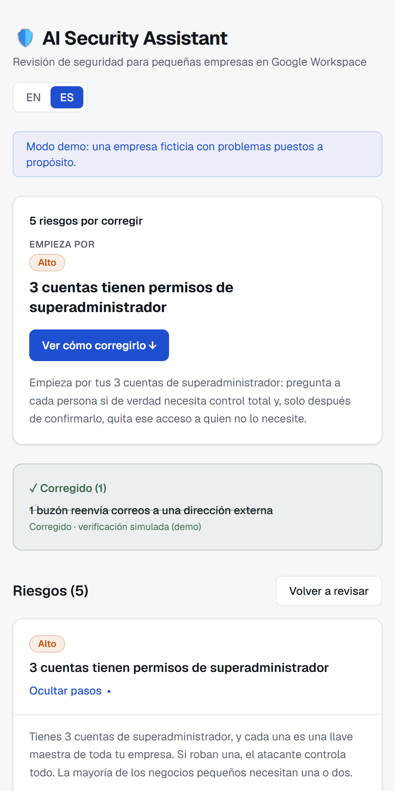

# 🛡️ AI Security Assistant for Small Businesses

A security check-up for small businesses on **Google Workspace**. It finds the most common
configuration risks — admins without 2-Step Verification, email forwarded outside the company,
files open to anyone with the link, unused accounts, risky third-party apps — scores them, and
uses **Claude** to explain each one in plain **English and Spanish**.

**▶ Live demo: [security.ailensao.cloud](https://security.ailensao.cloud)** — a fictional insurance agency
with problems planted on purpose. No sign-up; each visitor gets their own copy. Try the full loop:
open the first risk → *Mark as pending verification* → *Check again* → **Fixed · simulated verification**.

| Spanish | English | Phone |
|---|---|---|
|  |  |  |

> **Why:** In November 2026 Google reported the first fully autonomous AI-driven cyberattack.
> Large companies have security teams; a 10-person insurance agency in Miami usually has nobody.
> Google already gives recommendations, and several tools already audit Workspace. What small
> owners still lack is a simple loop to **fix one thing, prove it was fixed, and see what changed** —
> in their language, with evidence they can show an insurer or keep for a compliance file.

## Market and alternatives

This is a portfolio project, and similar products exist. The research — Google Security Advisor,
Overdrive, Esmeris, ArgusSec, Workspace Audit, dealer compliance suites like ComplyAuto, and how the app
maps (and does **not** map) to the FTC Safeguards Rule for auto dealers — is in
[docs/MARKET-RESEARCH.md](docs/MARKET-RESEARCH.md).

## How it works

1. **Collect** (read-only) the tenant's settings.
2. **Evaluate** with deterministic, unit-tested rules → findings and a 0–100 score.
3. **Explain** each finding with Claude (structured JSON output) in EN/ES.
4. **Act**: the page leads with the next action. The owner fixes it in Google Admin and marks it *pending verification*,
   or *accepts the risk* as a visible exception. Nothing is changed automatically.
5. **Verify**: only a new check can mark a risk as **Fixed**. In demo mode the fix is simulated, so the whole
   loop (Pending → Fixed · simulated verification) can be shown without a Google account.

See [docs/ARCHITECTURE.md](docs/ARCHITECTURE.md) for the data flow and the security decisions.

### Security decisions at a glance
- **Rules decide, AI explains** — the model cannot change severity or score.
- **Data minimization** — the AI receives only rule IDs, severities, counts, the kind of access and days without sign-in;
  never emails, names, file or app names. The request is built in one pure function (`src/lib/ai/request.ts`) with a
  test that fails if any identifying text from the tenant appears in it — including the trap file name.
- **Least privilege** — read-only Google scopes wherever Google offers one; exceptions documented.
- **Human in the loop** — decisions are recorded with a timestamp; "Fixed" is never a button, only the result of a new check. Stage 1 never writes to Google.
- **Titles are evidence** — titles are written by the rules from what was observed ("3 accounts have super admin permissions"), never by the AI.
- **Fail safe** — no API key or an AI error → standard templates; no password in production → access denied.

## Tech stack
Next.js 16 (App Router, Server Actions) · TypeScript · Tailwind CSS · SQLite (`node:sqlite`) ·
Anthropic SDK (Claude, structured outputs) · Google Admin SDK, Gmail and Drive APIs · Vitest · Docker

## Run it locally (demo mode, no Google account needed)

```bash
npm install
cp .env.example .env.local   # optional: add ANTHROPIC_API_KEY for AI explanations
npm run dev                  # http://localhost:3000
npm test                     # rule and auth tests
```

Demo mode shows **Sunrise Insurance Agency**, a fictional company with problems planted on purpose
(including a file whose name tries to trick the AI).

## Connect a real Google Workspace (`DATA_SOURCE=google`)

Use a **test tenant** (Google Workspace free trial) — never a client's account without a written agreement.

1. Google Cloud Console → create a project → enable **Admin SDK API**, **Gmail API**, **Google Drive API**.
2. Create a **service account** and a JSON key.
3. Google Admin → Security → API controls → **Domain-wide delegation** → add the service account's
   client ID with these scopes:
   ```
   https://www.googleapis.com/auth/admin.directory.user.readonly
   https://www.googleapis.com/auth/admin.directory.user.security
   https://www.googleapis.com/auth/gmail.settings.basic
   https://www.googleapis.com/auth/drive.metadata.readonly
   ```
   Why each one is needed is documented in `src/lib/collectors/google.ts`.
4. In `.env.local`: `DATA_SOURCE=google`, `GOOGLE_SERVICE_ACCOUNT_JSON` (one line), `GOOGLE_ADMIN_EMAIL`, `GOOGLE_DOMAIN`.

## Deploy with Docker

```bash
docker build -t ai-security-assistant .
docker run -p 3000:3000 -v sec-data:/data \
  -e APP_PASSWORD=change-me -e ANTHROPIC_API_KEY=... ai-security-assistant
```
Serve it over HTTPS (e.g. EasyPanel with a free certificate). The dashboard asks for user `owner`
and `APP_PASSWORD`.

### Public demo (for a portfolio link)
Set `DATA_SOURCE=demo` and `PUBLIC_DEMO=true`. Then:
- no password is needed, and it **refuses** to run with a real Google tenant;
- each visitor gets an anonymous cookie and their **own copy** of the fictional company;
- AI explanations are **cached** by a hash of the (non-identifying) request, so the AI is paid for once;
- max 20 checks per visitor per hour; visitor demos are deleted after 7 days.

## Limitations (on purpose)
This is a **posture check**, not a complete security product. It does not stop malware or ransomware
on computers, monitor in real time, or protect other systems (website, POS, accounting software).

## Roadmap
- **Stage 2:** near-real-time alerts from the Google Alert Center API (suspicious logins, phishing).
- **Stage 3:** approved one-click actions (sign out a user, force a password reset).
- **Stage 4:** endpoint signals from Wazuh / osquery.
